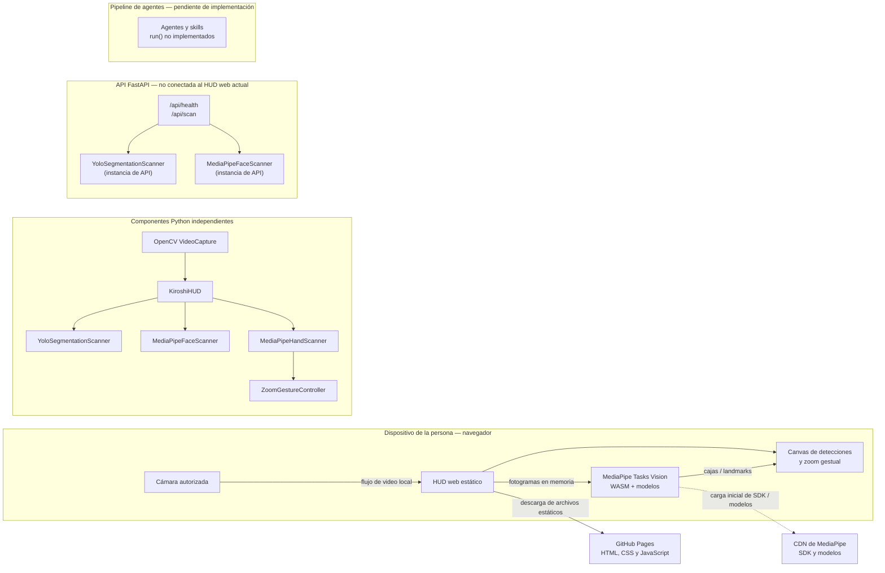
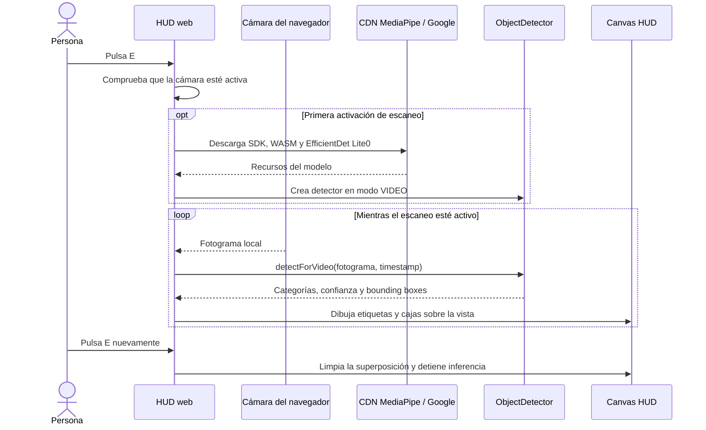
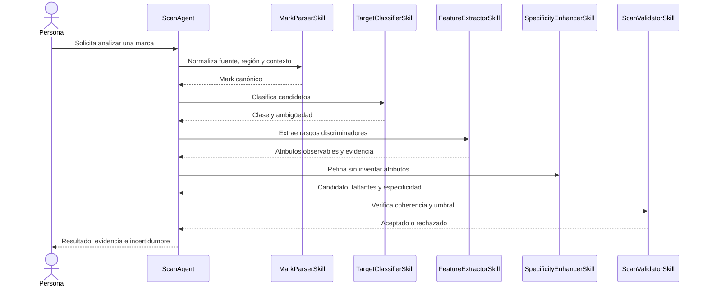

# Documento técnico — Kiroshi Optics

**Tipo:** descripción del sistema y arquitectura  
**Fecha:** 20 de noviembre de 2026  
**Estado:** implementación parcial; se distinguen las capacidades operativas del diseño aún no conectado.

## 1. ¿De qué trata el sistema?

Kiroshi Optics es un proyecto de asistencia visual inspirado conceptualmente en
las ópticas del videojuego *Cyberpunk 2077*. Su propósito es permitir que una
persona observe una escena mediante la cámara de su dispositivo y reciba
información visual contextual, procurando separar los rasgos observados de las
inferencias y hacer explícita la incertidumbre.

El proyecto no fabrica implantes oculares ni constituye un dispositivo médico.
Actualmente ofrece dos experiencias de HUD independientes:

1. **HUD web:** interfaz de primera persona publicada como sitio estático. El
   navegador solicita acceso a la cámara y procesa el video localmente. Permite
   detección general de objetos y zoom gestual.
2. **HUD de escritorio:** aplicación Python que captura video con OpenCV,
   cuenta rostros sin identificarlos, detecta algunas categorías de objetos y
   ofrece controles visuales y zoom por gesto.

El repositorio también contiene una API FastAPI para analizar fotogramas JPEG y
un marco de agentes y skills para identificar objetivos marcados con mayor
especificidad. La API no está conectada al HUD web actual y el pipeline de
agentes todavía no está implementado de extremo a extremo. Por ello, estos dos
componentes no deben confundirse con funciones activas del enlace público.

## 2. Objetivos

### 2.1 Objetivo general

Desarrollar una plataforma modular de asistencia visual que capture la escena
con permiso de la persona usuaria, detecte elementos relevantes y presente
resultados verificables en una interfaz HUD de baja obstrucción visual.

### 2.2 Objetivos específicos

- Capturar video desde cámaras compatibles en navegador y escritorio, sujeto a
  los permisos del sistema operativo y del navegador.
- Detectar y localizar categorías generales de objetos en la escena.
- Proporcionar una ampliación digital controlada mediante el gesto de pinza
  entre pulgar e índice.
- Mostrar el estado y los resultados de forma discreta, superpuestos a la vista.
- Diseñar un pipeline desacoplado de la cámara para analizar una región u
  objetivo que la persona haya marcado.
- Limitar las conclusiones a la evidencia visual disponible, conservar la
  incertidumbre y evitar inferir atributos no observables.
- Mantener explícitos los permisos y las fronteras de privacidad, especialmente
  cuando se usan servicios externos.
- Facilitar la sustitución de modelos, interfaces y proveedores mediante
  componentes modulares.

### 2.3 Fuera del alcance actual

OCR, traducción, identificación de personas e integración operativa del HUD con
el pipeline de agentes no forman parte de las funciones web actuales. El
detector web es una línea base de categorías generales; no garantiza la
identificación exacta de modelos de producto ni una precisión determinada.

## 3. Alcance y estado funcional

| Componente | Estado | Función y límites |
|---|---|---|
| HUD web | Operativo como sitio estático | `getUserMedia` muestra la cámara autorizada en el navegador. El botón **E** activa EfficientDet Lite0 mediante MediaPipe Tasks Vision, excluye `person` y permite hasta 20 resultados; **Z** activa el zoom por pinza. El objeto más cercano a la retícula muestra una descripción breve local. El reconocimiento de voz usa la API nativa del navegador; en espera solo acepta la frase de activación. |
| Modelos del HUD web | Descarga bajo demanda | El SDK MediaPipe Tasks Vision 0.10.14, EfficientDet Lite0 y el modelo Hand Landmarker se obtienen de CDN cuando se activa por primera vez la función correspondiente. Se requiere conexión para esa descarga. |
| HUD de escritorio | Operativo como aplicación local | OpenCV captura video; MediaPipe detecta rostros sin identificarlos y manos; YOLO11n-seg detecta un conjunto limitado de objetos. Escaneo y zoom se controlan con teclado. |
| Verificación web opcional del HUD de escritorio | Condicional | Si se configura `GEMINI_API_KEY`, puede enviarse una imagen recortada del objetivo seleccionado para búsqueda/verificación externa. No se envía un objetivo clasificado como persona. El uso depende de un proveedor externo. |
| API FastAPI | Implementada, independiente | `GET /api/health` informa disponibilidad. `POST /api/scan` acepta un fotograma JPEG de hasta 2 MiB, lo procesa en memoria y devuelve detecciones de objetos y rostros. La interfaz web actual no invoca este endpoint. |
| Agentes y skills | Diseño y contratos | Existen clases base, manifiestos, configuración y estructura de pipeline. Los métodos `run()` de agentes y skills lanzan `NotImplementedError`; el flujo de identificación de alta especificidad aún no está ejecutable. |
| OCR y traducción | Pendiente | No disponibles en esta versión. |

### Controles del HUD web

| Control | Acción |
|---|---|
| Activar vista | Solicita permiso para usar la cámara. |
| `E` | Alterna la detección local de objetos; excluye la clase `person`, dibuja cajas y etiquetas, y muestra una breve descripción del objeto más cercano a la retícula. |
| `Z` | Alterna el seguimiento de la mano para controlar el zoom con pulgar e índice. |
| Voz | En espera, **"detección de voz"** habilita el modo de comandos; **"escanear"** inicia el escaneo y **"zoom"** activa el seguimiento gestual. **"Apagar escáner"** y **"Zoom Out"** los desactivan; **"desactivar detección de voz"** vuelve al modo de espera. El botón de voz, la tecla `V` y los controles gráficos se conservan. |
| Deslizador de zoom | Ajusta manualmente la ampliación entre 0.7× y 3.0×. |
| `Q` | Desconecta la cámara. |

## 4. Arquitectura del sistema

El sistema se organiza en dos rutas operativas y dos componentes separados:

- **Ruta web local:** cámara del navegador → inferencia local MediaPipe →
  superposición del HUD. GitHub Pages entrega los archivos estáticos, pero no
  ejecuta inferencia ni recibe el video.
- **Ruta de escritorio:** cámara → OpenCV → detectores locales → composición del
  HUD de escritorio. La verificación opcional con Gemini puede enviar un
  recorte del objetivo, con las limitaciones descritas anteriormente.
- **API independiente:** cliente compatible → FastAPI → detectores Python →
  respuesta JSON. No es el backend del HUD web publicado actualmente.
- **Pipeline de agentes diseñado:** marca → parser → clasificación →
  extracción de rasgos → refinamiento → validación. Sus agentes y skills
  requieren implementación antes de considerarse una ruta funcional.

### Diagrama UML de componentes y despliegue lógico

La conexión punteada entre el navegador y el CDN corresponde únicamente a la
descarga de recursos estáticos y modelos. No representa envío de fotogramas.
La API FastAPI se muestra aparte porque la página web actual realiza la
inferencia en el navegador y no llama `/api/scan`.

## 5. Diagramas UML de interacción

### 5.1 Secuencia UML: escaneo de objetos en el HUD web

El flujo comienza después de que la cámara ya fue autorizada. En la primera
activación se descargan el SDK y el modelo; las activaciones posteriores
reutilizan los recursos cargados mientras viva la página.

### 5.2 Secuencia UML: pipeline de identificación diseñado

Este diagrama describe el flujo previsto por los manifiestos y la arquitectura,
no una funcionalidad ejecutable en la versión actual. Los métodos `run()` de
los participantes siguen sin implementar.

## 6. Diagrama UML de clases

El siguiente diagrama representa principalmente clases existentes en el HUD de
escritorio y los contratos del pipeline. Las clases de agente y skill están
implementadas como contratos/esqueletos, no como análisis completo.

```mermaid
classDiagram
  class KiroshiHUD {
    +run()
    -_camera
    -_scanner
    -_object_scanner
    -_hand_scanner
    -_zoom_controller
  }
  class MediaPipeFaceScanner {
    +detect(frame_bgr)
    +close()
  }
  class YoloSegmentationScanner {
    +submit(frame_bgr, now)
    +detect(frame_bgr)
    +snapshot()
    +close()
  }
  class ObjectDetection {
    +category
    +score
    +box
  }
  class MediaPipeHandScanner {
    +detect(frame_bgr)
    +close()
  }
  class HandScanResult {
    +thumb_tip
    +index_tip
    +finger_gap_ratio
  }
  class ZoomGestureController {
    +zoom
    +update(finger_gap_ratio, now)
  }
  class ZoomGestureStatus {
    +zoom
    +message
    +progress
  }
  class BaseAgent {
    <<abstract>>
    +run(task)
  }
  class ScanAgent {
    +PIPELINE
    +run(task)
  }
  class SpecificityAgent {
    +run(task)
  }
  class ContextAgent {
    +run(task)
  }
  class BaseSkill {
    <<abstract>>
    +run(params)
  }
  class MarkParserSkill {
    <<skeleton>>
    +run(params)
  }
  class TargetClassifierSkill {
    <<skeleton>>
    +run(params)
  }
  class FeatureExtractorSkill {
    <<skeleton>>
    +run(params)
  }
  class SpecificityEnhancerSkill {
    <<skeleton>>
    +run(params)
  }
  class ScanValidatorSkill {
    <<skeleton>>
    +run(params)
  }
  class ContextAggregatorSkill {
    <<skeleton>>
    +run(params)
  }
  class ReferenceLookupSkill {
    <<skeleton>>
    +run(params)
  }

  KiroshiHUD *-- MediaPipeFaceScanner : conteo anónimo
  KiroshiHUD o-- YoloSegmentationScanner : escaneo bajo demanda
  KiroshiHUD o-- MediaPipeHandScanner : zoom gestual
  KiroshiHUD *-- ZoomGestureController : suavizado y escala
  YoloSegmentationScanner ..> ObjectDetection : devuelve
  MediaPipeHandScanner ..> HandScanResult : devuelve
  ZoomGestureController ..> ZoomGestureStatus : produce
  BaseAgent <|-- ScanAgent
  BaseAgent <|-- SpecificityAgent
  BaseAgent <|-- ContextAgent
  BaseSkill <|-- MarkParserSkill
  BaseSkill <|-- TargetClassifierSkill
  BaseSkill <|-- FeatureExtractorSkill
  BaseSkill <|-- SpecificityEnhancerSkill
  BaseSkill <|-- ScanValidatorSkill
  BaseSkill <|-- ContextAggregatorSkill
  BaseSkill <|-- ReferenceLookupSkill
  ScanAgent ..> MarkParserSkill : pipeline declarado
  ScanAgent ..> TargetClassifierSkill : pipeline declarado
  ScanAgent ..> FeatureExtractorSkill : pipeline declarado
  ScanAgent ..> SpecificityEnhancerSkill : pipeline declarado
  ScanAgent ..> ScanValidatorSkill : pipeline declarado
```

`ScanAgent`, `SpecificityAgent`, `ContextAgent` y las skills heredan los
contratos base, pero sus métodos `run()` todavía lanzan `NotImplementedError`.

## 7. Interfaces y contratos principales

### API web independiente

| Ruta | Método | Entrada | Salida / comportamiento |
|---|---|---|---|
| `/` | GET | Ninguna | Sirve el `index.html` estático. |
| `/api/health` | GET | Ninguna | `{"status":"ok"}`. |
| `/api/scan` | POST | Cuerpo `image/jpeg`, máximo 2 MiB | JSON con dispositivo de inferencia, categorías, confianzas y cajas de objetos, además de cajas de rostros. Los fotogramas se decodifican en memoria y no se escriben a disco. |

La API limita a una inferencia simultánea por proceso y puede responder `429`
si ya está procesando otro fotograma. Los errores de tipo de contenido,
fotograma vacío, tamaño excedido o inicialización de dependencias se comunican
con códigos HTTP explícitos.

### Contrato del pipeline

`ScanAgent` declara los siguientes pasos: `mark_parser`,
`target_classifier`, `feature_extractor`, `specificity_enhancer` y
`scan_validator`. El esquema de entrada admite una marca con fuente, caja
delimitadora, texto o referencia a medios, además de pistas y nivel de
especificidad. La salida diseñada incluye clase objetivo, atributos,
especificidad, evidencias y elementos sin resolver.

La configuración del proyecto describe cinco niveles de taxonomía (L1–L5) con
pesos 0.15, 0.25, 0.30, 0.20 y 0.10. El umbral mínimo documentado es 0.55.
Estos parámetros no implican que el pipeline ya produzca esos resultados:
requieren que se implementen y evalúen las skills.

## 8. Requisitos, ejecución y despliegue

- **HUD web:** navegador con soporte para `getUserMedia`, cámara autorizada,
  conexión HTTPS (o localhost durante desarrollo) y conexión inicial a los CDN
  para cargar SDK y modelos.
- **GitHub Pages:** publica la interfaz estática; no ejecuta Python, FastAPI,
  PyTorch ni YOLO.
- **HUD de escritorio:** Python 3.10 o superior, OpenCV, MediaPipe,
  NumPy y Ultralytics/PyTorch; puede usar CPU o CUDA compatible.
- **API FastAPI:** dependencias web de `requirements-web.txt`; se puede ejecutar
  como servicio Python/Docker independientemente de GitHub Pages.

Para desplegar el HUD público, configura GitHub Pages para publicar la rama
`main` desde la raíz del repositorio. La página de entrada redirige al HUD web.
Para instrucciones del servicio Docker/API independiente, consulta
[`DEPLOY_WEB.md`](../DEPLOY_WEB.md).

## 9. Privacidad, seguridad y limitaciones

- El navegador solicita permiso explícito antes de usar la cámara y detiene sus
  pistas al desconectarla o cerrar la página.
- En el HUD web, los fotogramas se procesan en el dispositivo; el escaneo no
  transmite video al backend. La descarga de modelos sí contacta los CDN
  configurados.
- El reconocimiento de voz web se inicia después de autorizar la cámara y puede
  procesar audio mediante el servicio en línea del navegador. La aplicación no
  envía audio a su propio backend. El reconocimiento continuo está sujeto al
  soporte del navegador y a sus permisos.
- Las descripciones son textos predefinidos asociados a las categorías
  detectadas; no son explicaciones generadas por Gemini ni una identificación
  detallada del ejemplar. La categoría `teddy bear` representa peluches, no
  todos los juguetes.
- La API procesa fotogramas recibidos en memoria y no los almacena a disco; el
  despliegue del servidor implica que el cliente envía explícitamente la imagen
  a ese servicio.
- El detector facial de escritorio devuelve localizaciones para conteo y no
  identifica personas.
- La función opcional de consulta externa del HUD de escritorio tiene una
  frontera de privacidad distinta: puede transmitir un recorte del objetivo
  permitido al proveedor configurado.
- La detección general depende de iluminación, encuadre, cámara, capacidad del
  dispositivo y limitaciones del modelo. No equivale a una identificación
  exacta o certificada.
- La interfaz no reemplaza equipos ópticos, diagnósticos ni dispositivos
  médicos.

## 10. Evolución prevista

1. Mantener la interfaz web de baja obstrucción y medir latencia y resultados
   en dispositivos de distintas capacidades.
2. Implementar y evaluar las skills del pipeline antes de conectarlas al HUD.
3. Decidir, documentar y probar el flujo de privacidad para cualquier
   inferencia remota.
4. Considerar OCR y traducción como módulos independientes cuando exista una
   solución adecuada para los requisitos de tamaño, latencia y privacidad.
